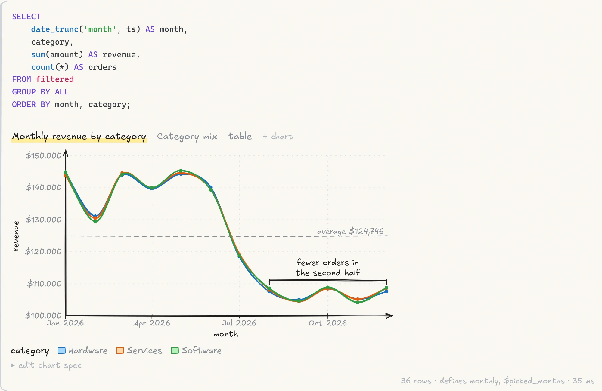

# Charts

A chart is a short YAML spec. The extension compiles it into one aggregate SQL query (grouping,
binning, time truncation and downsampling all happen in DuckDB) plus a small render description, and
the browser draws the result by hand. Because only the rows the picture needs leave DuckDB, a chart
of a hundred-million-row table is as quick to draw as a chart of a hundred rows.

This page is about putting charts in a notebook. [The chart spec](../reference/charts.md) lists every
chart type with a working example.

## A chart at the end of its query

The usual place for a chart is right after the query it draws, in a block comment that starts with
`chart`:

<!-- cell monthly in site/notebooks/charts_guide.sql -->

The query defines the data and the chart is a view of it. Add more `/* chart */` comments for more
views; each becomes a tab, in file order, and the result table is always the last tab:

<figure class="shot" markdown>

<figcaption>The <code>monthly</code> cell of <code>examples/revenue.sql</code>: two charts and the table, as tabs.</figcaption>
</figure>

- Only comments after the cell's **last statement** are charts. A `/* chart */` comment earlier in the
  cell is an ordinary comment, with a warning.
- The cell must end in a query. It need not be named.
- The spec can also sit on one line: `/* chart mark: bar */`.
- Editing a spec redraws its charts without running the query again.
- The file still runs as plain SQL: a chart is just a comment.

## A chart cell

A chart cell draws a chart of another cell, or of a table no cell defines:

<!-- cell revenue_kpi in site/notebooks/charts_guide.sql -->

Use one when one result feeds several charts that should be seen together (tabs show one at a time),
when a chart reads a table that is already in the database, or to put charts side by side with
`span=`. A chart cell's body is exactly one block comment.

## Choosing a chart

| Question | Spec |
|---|---|
| Change over time | `mark: line`, a date on `x` (add `timeunit: month` to bucket), `color:` for series |
| Volume over time | `mark: area`, or `mark: bar` with a `timeunit` |
| Compare categories | `mark: bar`; put the category on `y` with `sort: -x` for ranked horizontal bars |
| Part of a whole | `mark: bar` stacked by `color`; `mark: arc` only for two to five slices |
| Distribution | `mark: histogram` (`bin: {maxbins: 25}`), `mark: boxplot`, `mark: density` |
| Two measures | `mark: point` (binned automatically past 5,000 rows) or `mark: hexbin` |
| Two categories and a measure | `mark: rect` with `color: {field, agg, scheme}`, or `type: pivot` with `heat: true` |
| One headline number | `type: kpi` with a `sparkline`, or `type: gauge` with `bands` |
| Flows | `type: sankey`, `type: chord`, `type: network` |
| Hierarchy | `type: treemap`, `sunburst` or `icicle` with `path: [a, b]` |
| Steps, schedules, prices | `type: funnel`, `type: gantt`, `type: candlestick` |
| Days of the year | `type: calendar` |
| Places | `type: map` with `lat`/`lon`, or `geometry` with the spatial extension |
| A styled table | `type: table` with `columns`, `format`, `bar`, `heat`, `tip` |
| The same chart per group | add `facet: {col: region}` (or `row`) |
| A reference line or target range | `rules:` (`{y: avg}`, `{y: 150000}`) and `bands:` (`{y: [p25, p75]}`) |
| A remark about one point or period | `notes:` (`{x: 2026-02-01, text: short month}`) |

## Aggregating in the spec

A channel with `agg` makes the chart aggregate; every channel without one becomes a `GROUP BY` key.
So this draws total revenue per month and category from a table of individual orders, with no SQL:

```yaml
mark: line
x: {field: ts, timeunit: month}
y: {field: amount, agg: sum, format: "$,.0f", title: Revenue}
color: category
```

You do not need to pre-aggregate for size. A `line` over a continuous axis is reduced to at most four
points per horizontal pixel, and `point`, `rect` and `tick` over two numeric axes are binned to a
pixel grid past 5,000 rows. Pre-aggregate for meaning instead: a monthly line is easier to read than
a daily one.

## Labels that read well

- Give every chart a `title` that states the point ("Software leads every month"). In tabs the title
  is the tab's label, so keep it under about 30 characters.
- Put a `format` on every money, percentage or large number (`"$,.0f"`, `".1%"`, `".2s"`), and an
  axis `title` when a column name is code-like (`rev_usd`).
- Pointing at a mark shows its values, formatted with each channel's `format` and named by its
  `title`, plus any `tooltip:` fields. On lines and areas the nearest point answers.
- Handwriting is wide: shorten long categories in SQL (`left(name, 18)`), and prefer horizontal bars
  for long names.
- Bars and areas always start at zero. Lines zoom to their range; add `scale: {zero: true}` when the
  size of a change matters.

## Reference lines, bands and notes

A chart often needs a yardstick or a remark more than another series. Three spec keys add them without
any SQL:

```yaml
mark: line
x: month
y: {field: revenue, agg: sum, format: "$,.0f"}
rules:
  - {y: avg, label: "average {value}"}
  - {x: 2026-07-01, label: price change}
bands:
  - {y: [136000, 141000], label: target}
notes:
  - {x: 2026-02-01, text: "February is a short month", circle: true}
  - {x: [2026-05-01, 2026-08-01], text: steady summer}
```

Rules and bands sit behind the marks in muted ink; `avg`, `median`, `min`, `max` and `p05`…`p99`
are computed by DuckDB over what the chart draws. Notes are written after the marks, with an arrow to
their point, a ring with `circle: true`, or a bracket over a range. Keep note text to a few words:
handwriting is wide. See [the chart spec](../reference/charts.md#rules-bands-and-notes) for every
key, with pictures.

## Sizing and layout

`width=` and `height=` on the cell's `-- %%` line size its charts (640 by 320 by default, scaled to
fit). `span=` sets the cell's width in the reading view and exports; see
[reading and presenting](reading.md#laying-out-with-span).

## When a chart goes wrong

- **A chart error** marks the cell failed but keeps its table. The chart's tab shows ⚠ and the
  message.
- **Overdrawn bars**: `y: revenue` on a bar chart with many rows per `x`. Add `agg: sum`.
- **A typo draws a constant**: a bare name that is not a column is a constant (`color: red`). Write
  `{field: name}` to get an error instead.
- **Dates as text** give a categorical axis. Cast in SQL: `day::DATE`.
- **Too many colours**: filter to the top few categories in SQL, or facet.
- `notebook_chart_query(spec, relation)` shows the SQL a spec compiles to; see
  [the chart spec](../reference/charts.md#see-what-a-spec-compiles-to).
