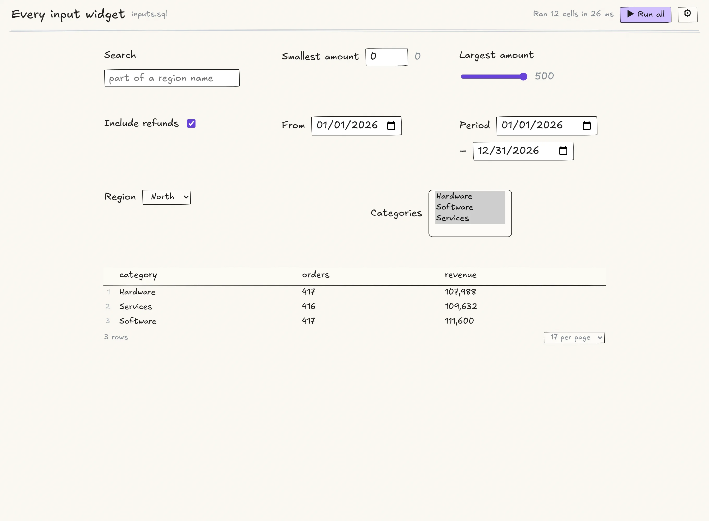

# Inputs and parameters

Parameters in a notebook are plain DuckDB variables. An input cell gives a variable a default and a
widget; queries read it with `$name`. Nothing about this is notebook-specific: the same file runs as a
script, where the `SET VARIABLE` line simply sets the default.

## An input cell

```sql
-- %% input region select from=regions.name label="Region"
SET VARIABLE region = 'EU';
```

The head names the variable (`region`) and the widget (`select`). The body is exactly one
`SET VARIABLE` statement for the same name, which sets the default. Queries read it:

```sql
-- %% filtered
SELECT * FROM orders WHERE region = $region;
```

When a reader moves the widget, the variable changes for that session and every cell that reads it,
and everything downstream, runs again. Moving a widget does not change the file; to change the
default, edit the `SET VARIABLE` line.

## The widgets

| Widget | Variable type | Options |
|---|---|---|
| `text` | `VARCHAR` | `placeholder` |
| `number` | `DOUBLE` | `min`, `max`, `step` |
| `slider` | `DOUBLE` | `min`, `max`, `step` |
| `checkbox` | `BOOLEAN` | |
| `date` | `DATE` | `min`, `max` |
| `daterange` | `STRUCT(lo DATE, hi DATE)` | `min`, `max` |
| `select` | the column's type, or text | `options=a,b,c` or `from=<cell>.<column>` |
| `multiselect` | a `LIST` of those | `options=…` or `from=<cell>.<column>` |

Every widget takes `label="…"`; without one it shows the variable's name. Input cells also take the
options every cell takes, such as `span=` to put several on one row.

`from=regions.name` fills a select with the values of column `name` of cell `regions`, and gives the
variable that column's type. It also makes the input depend on that cell, so `regions` must sit above
it. With `options=` the values are text.

Here is every widget in one notebook ([`site/notebooks/inputs.sql`](https://github.com/luke-falvey/duckdb-notebook/blob/main/site/notebooks/inputs.sql)):

```sql
--8<-- "site/notebooks/inputs.sql"
```

<figure class="shot" markdown>

<figcaption>The same notebook in the reading view. <code>span=</code> puts the widgets in rows.</figcaption>
</figure>

## Reading variables in SQL

- `$name` is DuckDB 2.0's shorthand for `getvariable('name')`, and works inside views, so a named
  query picks up a changed variable on its next read without being redefined.
- Struct and list variables work as you would expect: `$period.lo`, `list_contains($categories, x)`,
  `'EU' IN $regions`.
- `$name` on a variable that was never set is an error, while `getvariable('name')` returns `NULL`.
  The runner therefore sets every variable that some cell reads but nothing sets to `NULL` before the
  first cell runs. This is what makes [chart selections](selections.md) safe to read before anyone
  has clicked.
- Inside markdown, `{{ $region }}` shows a variable's value in the prose.

A variable read by some cell and set by none is a warning in `notebook_cells`, because it is usually
a typo.

## Variables set by SQL cells

Any cell may `SET VARIABLE`. The variable is defined by that cell, so cells below may read it:

```sql
-- %% latest
SET VARIABLE latest_day = (SELECT max(day) FROM sales);

-- %% recent
SELECT * FROM sales WHERE day > $latest_day - INTERVAL 7 DAY;
```

Such a variable is computed, so it has no widget and cannot be passed as a parameter (the cell would
overwrite it). Make it an input if a reader should change it.

## Parameters from outside

`notebook_run` and `notebook_export` take `params := {…}` to run a notebook with other values:

```sql
--8<-- "site/outputs/inputs_params.sql"
```

```text
--8<-- "site/outputs/inputs_params.txt"
```

A parameter replaces an input's default, or sets a variable that nothing in the notebook sets, such as
a chart selection. Unknown names are allowed and simply set a variable.

## Inputs in exports

A static HTML export shows inputs frozen at the values it ran with. To keep them working:

- `interactive := 'precomputed'` runs the notebook once per combination of input values, up to a
  budget, and the page switches between the results. It suits a few `select`, `checkbox` and stepped
  `slider` inputs.
- `format := 'html-wasm'` puts DuckDB-WASM in the page, so any input re-runs real SQL in the
  reader's browser.

See [exporting and sharing](exporting.md#inputs-that-still-work).
