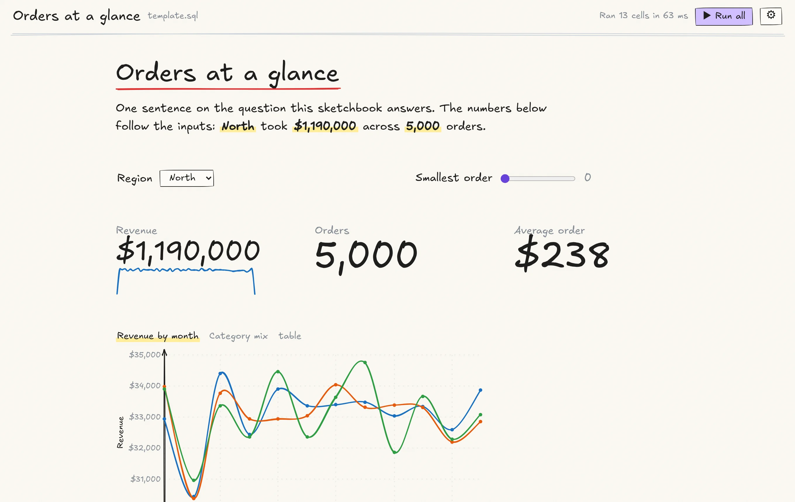

# Reading and presenting

The same notebook serves the person writing it and the people reading it. Everything that decides
how it reads (what is hidden, how wide each cell is, how many rows a table shows) is an option on a
cell's `-- %%` line, so it is saved in the file, reviewed like any edit, and holds in the editor's
reading view and in every export.

## The reading view

In the editor, open the ⚙ menu and press **Reading**. Code and editing controls disappear, and cells
are laid out on a 12-column grid by their `span=`:

<figure class="shot" markdown>

<figcaption>The <a href="https://github.com/luke-falvey/duckdb-notebook/blob/main/.github/skills/sketchbook-authoring/assets/template.sql">sketchbook template</a> in the reading view: plumbing hidden with <code>hide=</code>, inputs and KPIs in rows with <code>span=</code>.</figcaption>
</figure>

An [HTML export](exporting.md) looks like the reading view, with code shown unless hidden.

## Hiding code and output

`hide=` on a cell decides what readers see:

| `hide=` | Readers see |
|---|---|
| `none` (default) | Code and output |
| `code` | Output only: use it on queries whose result is the point |
| `output` | Code only |
| `all` | Nothing: use it for loading data and helper cells |

In the editor, the `</>` and `◫` buttons on a cell write `hide=code` and `hide=output` into its head.
The hidden part folds to a line you can click to peek at it. An export can hide more for every cell
with `hide :=` (see [exporting](exporting.md)); prose and inputs are never hidden by `output`.

## Laying out with span

`span=1` to `span=12` sets a cell's width on a 12-column grid. Consecutive cells whose spans add up
to 12 or less share a row, and cells in a row stretch to the tallest:

```sql
-- %% chart revenue_kpi from=filtered span=4
-- %% chart orders_kpi from=filtered span=4
-- %% chart average_kpi from=filtered span=4
```

Rows that work: `6+6`, `4+4+4`, `3+3+3+3` for KPIs, `8+4` for a chart and its note. Narrow cells
(`span=4` or less) suit KPIs, gauges, small bars and pies, not time series. A query cell's charts are
tabs, shown one at a time; to put two charts side by side, give them chart cells with `span=6`.

## A page that reads well

A shape that works, top to bottom:

```text
[markdown]  # Title, one sentence on the question, the answer with {{ }} values
input span=6 | input span=6
chart kpi span=4 | chart kpi span=4 | chart kpi span=4
query hide=code with /* chart */ tabs          the main chart, full width
[markdown]  ## Section heading and a sentence or two
chart span=6 | chart span=6
query hide=code rows=10                        the detail table
```

- Use exactly one `#` heading; it gets the red underline. Use `##` for sections.
- Put the key numbers in prose with `{{ }}`, formatted in SQL; they get a highlighter mark.
- Keep paragraphs short. The handwriting is large and wide.
- Hide the plumbing (`hide=all` on loading cells, `hide=code` on results).

The repository's [sketchbook template](https://github.com/luke-falvey/duckdb-notebook/blob/main/.github/skills/sketchbook-authoring/assets/template.sql)
follows this shape.

## Tables

A result table pages through its rows, 25 at a time unless the reader picks another default in the ⚙
menu. `rows=N` on a cell fixes its page size (1 to 10,000); the page-size picker under a table writes
it for you. Wide tables page through their columns too.

## Light and dark

The ⚙ menu's ◐ button switches the editor between light and dark, and the choice is remembered in
your browser. Exports are always light.

## The pen

Every piece of the page is written by a pen as it appears: headings and prose letter by letter, SQL
as if typed, charts axes first, then marks, then labels. Only what is new or changed is written, so
re-running a cell rewrites only its result.


The ⚙ menu's **handwriting** setting is `gentle` (the default), `slow` or `off`, remembered in your
browser. It is off when the system asks for reduced motion, when printing, in PDF exports, and when the
page's URL has `ink=off`. The finished page is identical either way.
