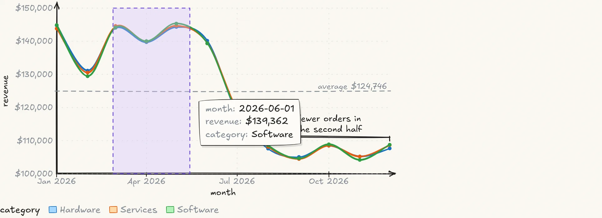
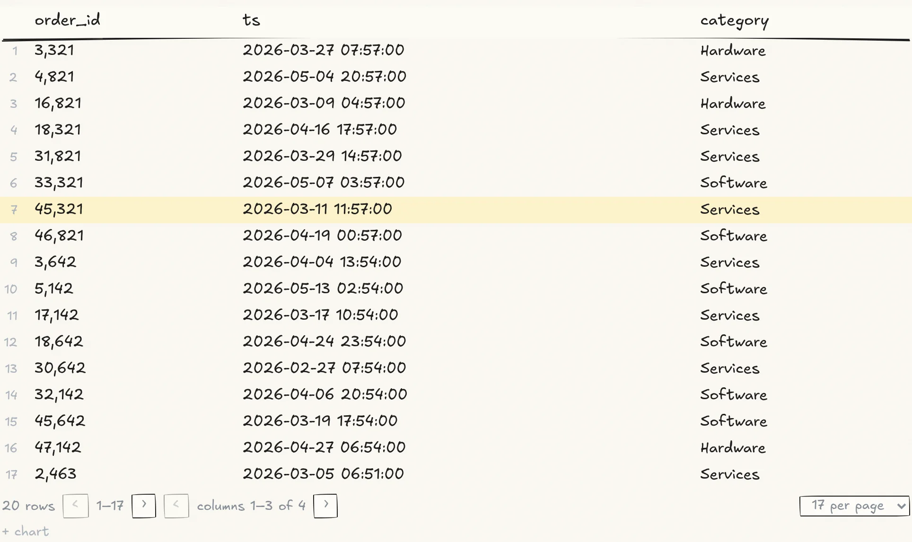

# Selections and cross-filtering

A chart can write what the reader selects into a DuckDB variable. Cells that read the variable run
again, and other charts can filter on it without any SQL. It is the same mechanism as an
[input](inputs.md): a selection is just a variable that a chart sets.

## Brushing a range

Add `select` to a chart's spec. This line chart, from `examples/revenue.sql`, lets the reader drag
across months:

<!-- cell monthly in examples/revenue.sql -->

`select: {as: picked_months, type: interval, on: x}` writes the brushed range into
`$picked_months`. A cell below reads it:

<!-- cell top_orders in examples/revenue.sql -->

<figure class="shot" markdown>


<figcaption>Dragging across the chart sets <code>$picked_months</code>, and <code>top_orders</code> runs again with orders from that range only. A click clears the brush.</figcaption>
</figure>

**Always guard a selection** with `$x IS NULL OR …`. Before anyone selects anything, the variable is
`NULL`: the runner sets every variable that is read but never set to `NULL` before the first cell
runs, so `$picked_months` does not raise a missing-variable error.

## What the variable holds

| `type` | `on` | Variable value |
|---|---|---|
| `interval` | one channel, `x` or `y` | `STRUCT(lo, hi)` |
| `interval` | `[x, y]` | `STRUCT(x STRUCT(lo, hi), y STRUCT(lo, hi))` |
| `point` | a channel | `LIST` of the selected values of that channel's field |

The values have the type of the selected field. A brush on a `DATE` axis gives `TIMESTAMP` bounds,
because a brush can end between days.

In the editor and in exports:

- **interval**: drag to brush; a click clears it.
- **point**: click a mark to select it; <kbd>Shift</kbd>+click adds to the selection.

## Clicking marks

```yaml
select: {as: picked_region, type: point, on: x}
```

`$picked_region` is a list, so test membership:

```sql
WHERE $picked_region IS NULL OR list_contains($picked_region, region)
```

## Cross-filtering without SQL

`filter:` applies another chart's selection to this chart's data, matching the selection's field by
name. From the chart gallery: clicking a bar of the first chart filters the second.

<!-- cell revenue_by_region -->

<!-- cell trend -->

`filter` takes one selection or a list, `[a, b]`. A filter only redraws the chart: the cell's query
does not run again, so cross-filtering is fast even when the query is slow.

## Rules

- `select` and `filter` are read from the top level of a spec only, not inside `layers`.
- A selection belongs to the cell whose chart defines it, and **a cell's own SQL may not read its own
  chart's selection**: the query would depend on a chart of itself. Put the filtered query in a new
  cell below, as `top_orders` does above. A cell's charts may `filter` on any selection, including
  their own.
- A chart cell drawn `from` a cell that reads that chart's own selection is a cycle, which is an
  error.

## Selections outside the editor

- `notebook_run(path, params := {picked_region: ['North']})` runs the notebook as if that selection
  were made.
- A static HTML export, including one with `interactive := 'precomputed'`, draws the page as the
  run left it: brushing and clicking do nothing there. In an `html-wasm` export, selections and
  `filter` work as in the editor, because the queries run again in the reader's browser. See
  [exporting](exporting.md#inputs-that-still-work).
