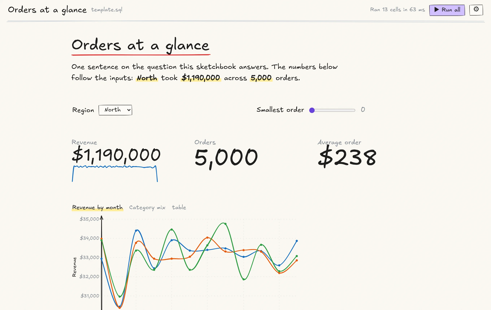

# duckdb-sketchbook

<p class="lede">A notebook for DuckDB where the notebook is a plain <code>.sql</code> file.</p>

duckdb-sketchbook is a DuckDB extension. It reads a `.sql` file whose cells are marked with comments,
works out how the cells depend on each other, runs them, and serves an editor in your browser from
the DuckDB process you already have. Charts are short YAML specs that compile to aggregate queries.
Notebooks can be stored in the database with their history, and exported to a single HTML file that
needs no DuckDB.

<a class="button" href="start/install/">Install</a>
<a class="button plain" href="start/first-notebook/">Your first notebook</a>
<a class="button plain" href="examples/">See a live notebook</a>

<figure class="shot" markdown>

<figcaption>A notebook in the editor's reading view. The same file is plain SQL.</figcaption>
</figure>

## A notebook is valid SQL

```sql
--8<-- "site/notebooks/hello.sql"
```

Cell boundaries, prose and chart specs live in comments. The file diffs cleanly, runs in any DuckDB
client, and is easy for people and agents to edit. A named query becomes a view that later cells read
by name, and `$region` is an ordinary DuckDB variable, which the input cell sets.

## What you can do with it

<div class="cards" markdown>
<a class="card" href="guides/writing/"><strong>Write</strong><span>Cells, names, dependencies, prose with live values.</span></a>
<a class="card" href="guides/charts/"><strong>Chart</strong><span>Line, bar, maps, sankeys, KPIs and more, drawn by hand.</span></a>
<a class="card" href="guides/inputs/"><strong>Parameterise</strong><span>Sliders, selects and dates that set DuckDB variables.</span></a>
<a class="card" href="guides/selections/"><strong>Cross-filter</strong><span>Brush or click a chart; the cells that read it update.</span></a>
<a class="card" href="guides/storing/"><strong>Store</strong><span>Keep notebooks in the database, with every version.</span></a>
<a class="card" href="guides/cache/"><strong>Reopen</strong><span>A notebook opens showing its last results, marked when stale.</span></a>
<a class="card" href="guides/exporting/"><strong>Share</strong><span>One HTML file, PDF, Markdown, plain SQL or Parquet.</span></a>
<a class="card" href="guides/headless/"><strong>Automate</strong><span>Run a notebook from SQL, a script or CI.</span></a>
<a class="card" href="reference/format/"><strong>Look it up</strong><span>The format, every chart key, every function.</span></a>
</div>

## How it fits together

- **It runs inside your DuckDB.** `CALL notebook_start('report.sql')` starts a small HTTP server on
  127.0.0.1 inside the DuckDB process and opens the editor. The frontend is compiled into the
  extension; no network access is needed.
- **Cells are reactive.** Change an input or brush a chart and the cells that read it run again.
- **Charts are declarative.** The extension compiles each spec to one aggregate query, so the
  browser receives only the rows the picture needs, even from a large table.
- **It looks like a sketchbook.** Paper, handwriting and hand-drawn charts, in the editor and in
  every export. Each piece is written onto the page by a pen as it appears.

!!! note "Status"
    Early, but every part of the design works. Not built yet: a CodeMirror editor, and charting
    libraries for zoomable maps (charts are drawn by the built-in SVG renderers). The
    notebook format is version 1, still marked draft.
