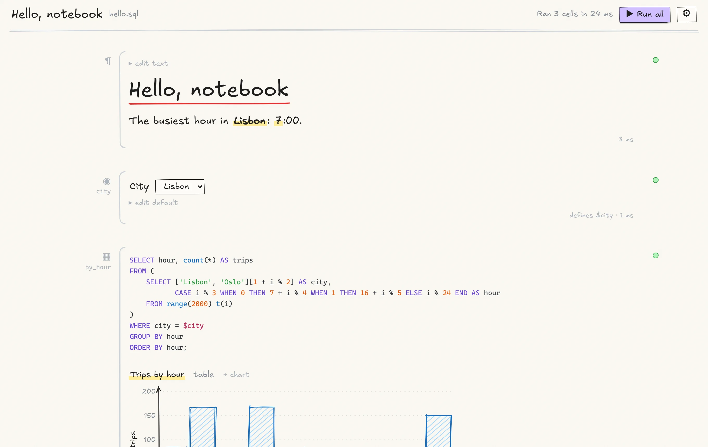
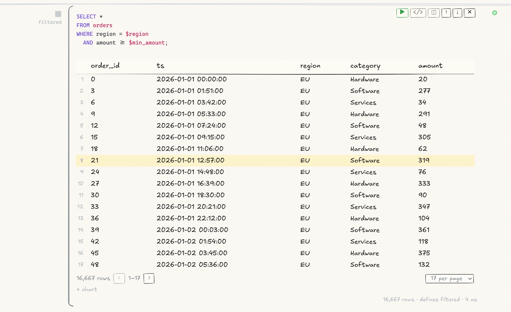
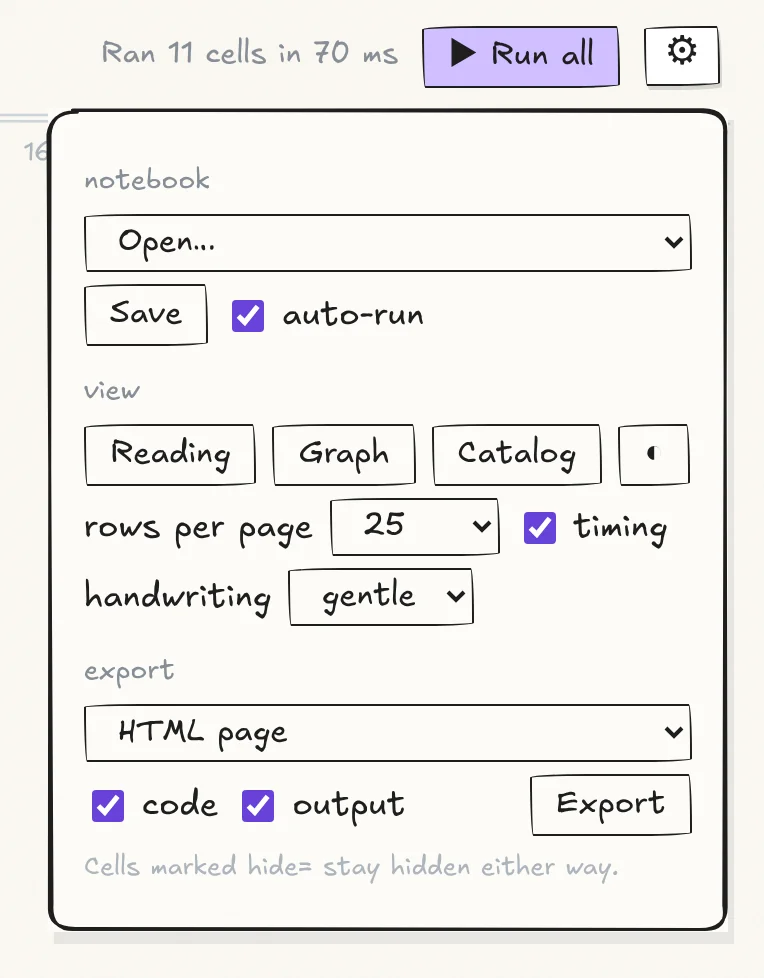
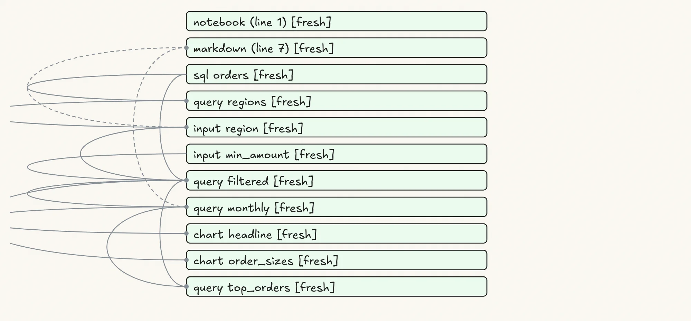

# The editor

`CALL notebook_start('report.sql')` opens the editor in your browser. It is served by the DuckDB
process you called it from, on 127.0.0.1, and edits the `.sql` file directly.

<figure class="shot" markdown>

</figure>

## Keyboard

| Keys | Where | Does |
|---|---|---|
| <kbd>Shift</kbd>+<kbd>Enter</kbd> (or <kbd>Ctrl</kbd>/<kbd>⌘</kbd>+<kbd>Enter</kbd>) | in a cell | Run the cell, and with auto-run on, the cells that depend on it. In a chart spec: redraw the chart without running the query |
| <kbd>Ctrl</kbd>/<kbd>⌘</kbd>+<kbd>Shift</kbd>+<kbd>Enter</kbd> | anywhere | Run all |
| <kbd>Ctrl</kbd>/<kbd>⌘</kbd>+<kbd>S</kbd> | anywhere | Save the file |
| <kbd>Ctrl</kbd>+<kbd>Space</kbd> | in SQL | Complete cell names, tables, columns and `$variables`; <kbd>Enter</kbd> or <kbd>Tab</kbd> picks, <kbd>Esc</kbd> closes |
| <kbd>Tab</kbd> | in a cell | Insert four spaces |
| <kbd>Enter</kbd> / <kbd>Esc</kbd> | in a cell's `-- %%` line | Keep / cancel the change |
| <kbd>Esc</kbd> | ⚙ menu open | Close it |
| <kbd>→</kbd> <kbd>←</kbd> <kbd>Space</kbd> <kbd>Home</kbd> <kbd>End</kbd> <kbd>F</kbd> <kbd>Esc</kbd> | presenting | Next, back, first, last, full screen, stop ([presenting](../guides/reading.md#presenting)) |

## A cell

<figure class="shot" markdown>

</figure>

- **Left margin**: the cell's kind and its name. Click either to edit the `-- %%` line.

    | Symbol | Kind |
    |---|---|
    | ☰ | Notebook settings (`[notebook]`) |
    | ¶ | Text (`[markdown]`) |
    | ◉ | Input |
    | ▦ | Query: its result is a table, with charts as tabs |
    | ✎ | SQL that changes the database (an effect cell) |
    | ∿ | Chart |

- **Right margin**: the state dot: fresh, stale (something it reads changed), running or failed.
  A stale result kept from an earlier session is drawn in fainter ink with the note *from an earlier
  run* until the cell runs ([keeping results](../guides/cache.md)).
- **Buttons**, shown when the pointer is over the cell, top right: ▶ run, `</>` hide code, `◫` hide
  output, ↑ and ↓ move, ✕ delete. The hide buttons write `hide=` into the `-- %%` line.
- **Bottom right**: rows returned, what the cell defines, and how long it took (hidden with
  `timing: false`).
- **Between cells**: buttons to add an SQL, Markdown or Input cell appear when the pointer is
  between two cells.
- Markdown shows rendered; double-click it, or use "edit text", to edit. Inputs have "edit default"
  for their `SET VARIABLE` line.

## Results and charts

- A result table pages through rows and, when wide, columns. The page-size picker writes `rows=`
  into the cell.
- A query with charts shows one tab per chart and a **table** tab. "edit chart spec" opens the spec
  of the current tab.
- **+ chart** opens the chart picker: choose a mark and the x, y and colour columns, or let it
  suggest one, and it writes a `/* chart */` comment into the cell.
- Pointing at a chart shows the values under the pointer. Drag to brush, click to select, if the
  chart has a [selection](../guides/selections.md).

## The ⚙ menu

<figure class="shot" markdown>

</figure>

| Item | Does |
|---|---|
| Notebook picker | Open another notebook: the `.sql` files in DuckDB's working directory, notebooks stored in the database, and those already open |
| **Save** | Write the file (or a new version, for a `db:` notebook) |
| **auto-run** | Re-run cells when something they read changes. Off: they turn stale instead |
| **keep results** | Keep each cell's last result so the notebook reopens showing it. Writes `cache:` into the `[notebook]` cell |
| **Forget** | Clear the results kept for this notebook |
| **Reading** | The [reading view](../guides/reading.md): no code, cells on the `span=` grid |
| **Present** | [Present](../guides/reading.md#presenting) the notebook one screen at a time: arrows, Space or a click move, <kbd>F</kbd> for full screen, <kbd>Esc</kbd> leaves |
| **Graph** | The dependency graph |
| **Catalog** | A side panel of tables, views and their columns. Click a column to insert it; drag or double-click a table |
| ◐ | Light or dark |
| rows per page | Default page size for tables without `rows=`, remembered in this browser |
| timing | Show run times; writes `timing:` into the `[notebook]` cell |
| handwriting | `gentle`, `slow` or `off`; remembered in this browser |
| Export | HTML, HTML with inputs precomputed, PDF (prints the reading view from the browser), Markdown or SQL, with or without code and output |

## The dependency graph

<figure class="shot" markdown>

</figure>

One row per cell, with a curve to each cell it reads. A dashed curve is a read of a cell further
down, which only markdown and chart cells may do. Click a row to jump to the cell. A cell's first
error shows in red beside it.

## Files and sessions

- A notebook opens showing the results [kept](../guides/cache.md) from its last run, without running
  anything.
- The editor keeps a **session** per notebook: its variables and views live as long as the server.
  Each request runs in a fresh connection that replays them, so the editor never holds your database
  open.
- Edits are not written until you save. Closing the tab with unsaved edits asks first.
- If the file changes on disk (another editor, `git checkout`), the page reloads it. If you also
  have unsaved edits, it asks which to keep.
- **■ Stop** in the toolbar interrupts a running query.
