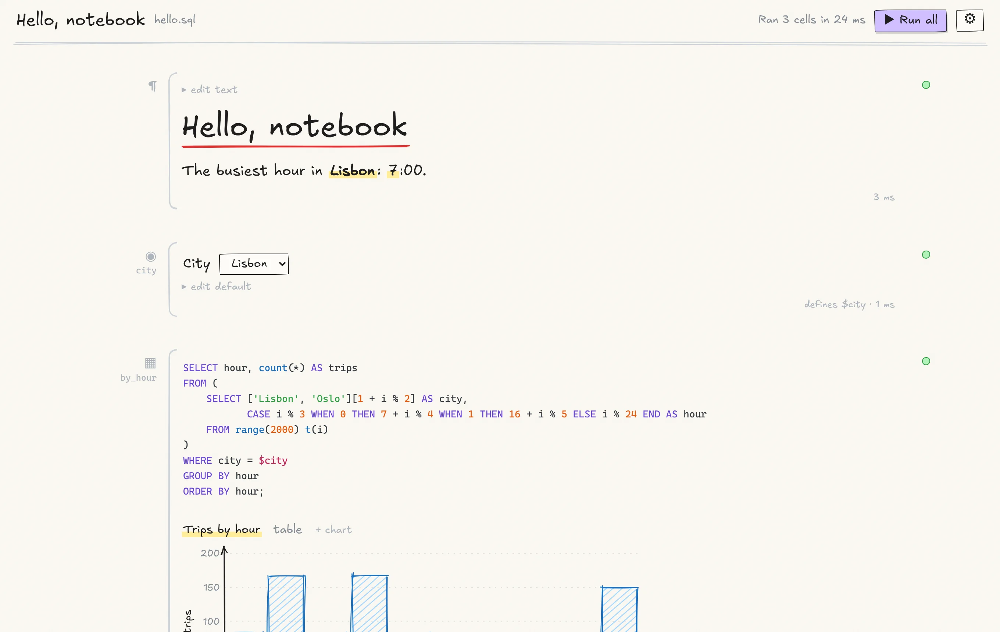

# Your first notebook

This page takes you from an empty file to a shared HTML page in about five minutes. It assumes the
extension is [installed](install.md); the commands are typed in a DuckDB shell that has it loaded.

## 1. Write the file

A notebook is a `.sql` file. Save this as `hello.sql`:

```sql
--8<-- "site/notebooks/hello.sql"
```

It has three cells, each starting with a `-- %%` line:

- a **markdown** cell: prose in one block comment, with `{{ }}` values computed by DuckDB;
- an **input** cell: a select box that sets the variable `$city`;
- a **query** cell named `by_hour`, with a chart spec in a comment after it.

Because every line is SQL or a comment, the file still runs as a script in any DuckDB 2.0.

## 2. Check it

```sql
--8<-- "site/outputs/hello_cells.sql"
```

```text
--8<-- "site/outputs/hello_cells.txt"
```

`notebook_cells` parses the file without running it. It shows what each cell defines and reads, and
any errors. The markdown cell reads `by_hour` even though it sits above it: prose may quote results
from anywhere, while SQL cells may only read cells above them.

## 3. Open it in the editor

```sql
CALL notebook_start('hello.sql');
```

This starts a server inside the DuckDB process, on 127.0.0.1, and opens your browser at a URL with
a random token. Keep the DuckDB shell open: the server stops when DuckDB exits.

Opening a notebook does not run it. Press **▶ Run all**:

<figure class="shot" markdown>

</figure>

Each cell's kind and name are in its left margin, and its state dot is on the right. Point at a bar
to see its values.

Now pick **Oslo** in the select. The variable `$city` changes, and the cells that read it run again:
the query, its chart, and the sentence above it.

## 4. Edit and save

Click into the query and change `count(*) AS trips` to `count(*) * 2 AS trips`, then press
<kbd>Shift</kbd>+<kbd>Enter</kbd> to run that cell and everything that depends on it. Press
<kbd>Ctrl</kbd>+<kbd>S</kbd> (<kbd>⌘</kbd>+<kbd>S</kbd> on a Mac) to write the file. If you edit
`hello.sql` in another editor instead, the browser picks the change up.

## 5. Share it

```sql
--8<-- "site/outputs/hello_export.sql"
```

```text
--8<-- "site/outputs/hello_export.txt"
```

`hello.html` is a single file with the results, charts and fonts inside it. It needs no DuckDB and
no network: send it, attach it, or publish it. [Exporting and sharing](../guides/exporting.md) covers
PDF, Markdown, plain SQL, Parquet and pages whose inputs still work.

## 6. Run it without a browser

```sql
--8<-- "site/outputs/hello_run.sql"
```

```text
--8<-- "site/outputs/hello_run.txt"
```

`notebook_run` runs every cell in a session of its own and reports each one, in the order they
ran: the markdown cell runs last because its `{{ }}` value reads `by_hour`. That is how a notebook
runs in a script or in CI: see [running headless](../guides/headless.md).

## When you are done

```sql
CALL notebook_stop();
```

Or just quit DuckDB.

## Where next

- [Writing a notebook](../guides/writing.md): cell kinds, names, dependencies and options.
- [Charts](../guides/charts.md): every chart type, with the spec that draws it.
- [The examples](../examples/index.md): open a finished notebook in your browser.
